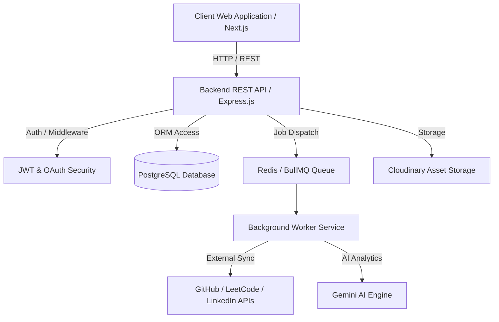
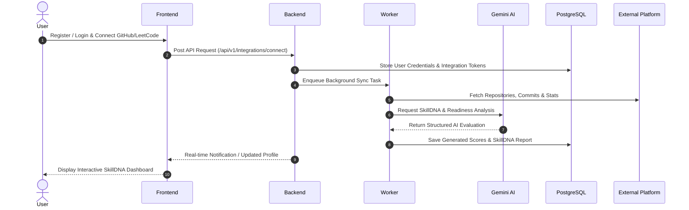

# SkillDNA AI — Your Living Technical Identity

[](https://opensource.org/licenses/MIT)
[]()
[](https://nodejs.org/)
[](https://nextjs.org/)
[](https://expressjs.com/)
[](https://www.postgresql.org/)
[](https://www.prisma.io/)
[](https://www.typescriptlang.org/)
[](https://ai.google.dev/)
[]()

SkillDNA AI is an enterprise-grade, AI-powered full-stack web application designed to create a dynamic, continuously evolving technical profile for students and software professionals. Unlike a static resume, SkillDNA AI automatically aggregates, verifies, and analyzes technical performance from GitHub, LeetCode, HackerRank, LinkedIn, projects, certifications, and hackathons using Artificial Intelligence.

---

## Project Banner

```
+-----------------------------------------------------------------------------------+
|                                                                                   |
|                                 SKILLDNA AI                                       |
|                       "Your Living Technical Identity"                            |
|                                                                                   |
|            [ Interactive Dashboard & AI Analytics Screenshot Placeholder ]         |
|                                                                                   |
+-----------------------------------------------------------------------------------+
```

---

## Table of Contents
- [About the Project](#about-the-project)
- [Key Features](#key-features)
- [Project Architecture](#project-architecture)
- [Technology Stack](#technology-stack)
- [Folder Structure](#folder-structure)
- [Application Workflow](#application-workflow)
- [Screenshots](#screenshots)
- [Installation](#installation)
- [Environment Variables](#environment-variables)
- [API Overview](#api-overview)
- [AI Modules](#ai-modules)
- [Security](#security)
- [Performance](#performance)
- [Development Roadmap](#development-roadmap)
- [Future Scope](#future-scope)
- [Contributing](#contributing)
- [License](#license)
- [Author](#author)
- [Acknowledgements](#acknowledgements)

---

## About the Project

### Why SkillDNA AI Exists
Traditional paper resumes fail to reflect a developer's real, live capabilities. They are static, easily exaggerated, difficult for recruiters to verify, and fail to capture ongoing continuous learning.

### Problems Solved
* **For Students & Candidates**: Eliminates static resumes by automatically building a live, verified portfolio that updates as they commit code, solve algorithms, and complete certifications.
* **For Recruiters & Employers**: Provides verified, AI-driven skill scores and career readiness metrics, bypassing manual resume screening and reducing hiring bias.
* **For Universities & Mentors**: Offers visibility into student skill growth, enabling targeted mentorship and curriculum alignment.

---

## Key Features

| Feature Category | Description |
| :--- | :--- |
| **Authentication & Authorization** | Secure JWT-based authentication, Google OAuth 2.0 integration, and granular Role-Based Access Control (RBAC). |
| **Platform Integrations** | Data aggregation pipelines for GitHub, LeetCode, HackerRank, LinkedIn, custom projects, certifications, and hackathons. |
| **SkillDNA Score** | Real-time AI engine calculating a holistic technical identity score across code quality, problem solving, and breadth. |
| **Skill Verification Engine** | Automated proof-of-work verification that audits repository commit history, code structure, and credential authenticity. |
| **Career Readiness Score** | Predictive benchmark matching candidate profiles against real-world job roles and industry demands. |
| **AI Resume Analyzer** | Deep NLP analysis of candidate uploaded resumes compared against verified platform data. |
| **AI Portfolio Analyzer** | Structural inspection and code-quality evaluation of linked web projects and repositories. |
| **AI Mentor & Roadmap** | Personalized growth advice and step-by-step skill acquisition roadmaps generated via Gemini AI. |
| **Recruiter Dashboard** | Search, filter, and review verified candidate profiles with benchmark analytics. |
| **SkillDNA Wrapped** | Annual technical journey recap visualizing growth milestones, top languages, and achievements. |

---

## Project Architecture



---

## Technology Stack

| Layer | Technology | Purpose |
| :--- | :--- | :--- |
| **Frontend** | Next.js 14, React 18, TypeScript, Tailwind CSS | High-performance, responsive UI web interface |
| **Backend** | Node.js, Express.js, TypeScript | RESTful API domain services and business logic |
| **Database** | PostgreSQL 16, Prisma ORM | Relational data persistence and schema management |
| **Caching & Queues** | Redis 7, BullMQ | Asynchronous task processing, caching, and rate limiting |
| **AI Processing** | Gemini API | Neural scoring, text analysis, and mentorship engines |
| **File Storage** | Cloudinary | Secure storage for user avatars, resumes, and project media |
| **Monorepo / Build** | PNPM Workspaces, TurboRepo | High-speed workspace dependency management & caching |

---

## Folder Structure

```
SkillDNA-AI/
├── frontend/             # Next.js client web application
├── backend/              # Node.js + Express REST API microservices
├── database/             # Prisma ORM schemas, migrations & seeders
├── worker/               # Background asynchronous task processing worker
├── shared/               # Shared TypeScript types, contracts & validators
├── docs/                 # Complete system architectural documentation
├── scripts/              # Setup, migration, and automation scripts
├── infrastructure/       # Docker, CI/CD, and deployment configurations
├── prompt-library/       # System AI prompt templates & versioning
└── assets/               # Static media, visual design system assets
```

---

## Application Workflow



---

## Screenshots

* **Landing Page**: `(Screenshot Placeholder)`
* **Dashboard**: `(Screenshot Placeholder)`
* **Projects**: `(Screenshot Placeholder)`
* **SkillDNA Score**: `(Screenshot Placeholder)`
* **Career Readiness**: `(Screenshot Placeholder)`
* **AI Mentor**: `(Screenshot Placeholder)`
* **Recruiter Dashboard**: `(Screenshot Placeholder)`
* **Public Profile**: `(Screenshot Placeholder)`

---

## Installation

### Prerequisites
* Node.js >= 20.0.0
* PNPM >= 9.0.0
* Docker & Docker Compose

### Step-by-Step Setup
1. **Clone Repository**:
   ```bash
   git clone https://github.com/parmeshks/SkillDNA-AI.git
   cd SkillDNA-AI
   ```
2. **Environment Configuration**:
   ```bash
   cp .env.example .env
   ```
3. **Install Workspace Dependencies**:
   ```bash
   pnpm install
   ```
4. **Start Local Infrastructure (PostgreSQL & Redis)**:
   ```bash
   docker-compose up -d postgres redis
   ```
5. **Database Migration & Seeding**:
   ```bash
   pnpm run db:migrate
   pnpm run db:seed
   ```
6. **Start Development Services**:
   ```bash
   pnpm run dev
   ```

---

## Environment Variables

| Variable | Description | Default |
| :--- | :--- | :--- |
| `NODE_ENV` | Application execution environment (`development`/`production`) | `development` |
| `SERVER_PORT` | REST API HTTP port | `5000` |
| `DATABASE_URL` | PostgreSQL connection string | `postgresql://...` |
| `REDIS_HOST` | Redis host for cache & BullMQ | `localhost` |
| `JWT_SECRET` | Secret key for access tokens | Required |
| `GEMINI_API_KEY` | Google Gemini AI API key | Required |

*(See [.env.example](file:///.env.example) for complete list).*

---

## API Overview
The REST API follows standardized RESTful principles under `/api/v1`. Full OpenAPI specification and endpoint documentation can be found in `docs/API/`.

---

## AI Modules
* **SkillDNA Engine**: Computes dynamic skill scores based on code volume, complexity, and commit frequency.
* **Resume Analyzer**: Compares candidate uploaded resumes against verified platform proof-of-work.
* **Portfolio Analyzer**: Evaluates repository code structure, test coverage, and documentation quality.
* **Career Predictor**: Identifies gaps between candidate profiles and desired job target profiles.
* **AI Mentor**: Generates customized learning paths and actionable skill acquisition advice.

---

## Security
* Strict JWT authentication with short-lived access tokens and refresh rotation.
* Role-Based Access Control (`STUDENT`, `RECRUITER`, `MENTOR`, `ADMIN`).
* Password hashing using `bcrypt` (12 rounds).
* Rate limiting on public and AI-heavy endpoints.

---

## Performance
* Parallel execution and turborepo caching.
* Asynchronous worker queues for long-running API fetches and AI calls.
* Server-side rendering and static optimization via Next.js 14.

---

## Development Roadmap
- [x] Phase 1: Project Foundation & Architecture
- [ ] Phase 2: Database Schemas & Shared Contracts
- [ ] Phase 3: Backend Domain Services & REST APIs
- [ ] Phase 4: Frontend UI Design System & Applications
- [ ] Phase 5: Background Workers & Platform Sync Pipeline
- [ ] Phase 6: AI Analytics Engines & Verification
- [ ] Phase 7: Recruiter Platform & Final Deployment

---

## Future Scope
* Native Mobile Application (React Native).
* IDE & Browser Extensions for automatic activity tracking.
* AI Interview Simulator with real-time feedback.
* On-chain Blockchain Proof-of-Skill verification.

---

## Contributing
Contributions are welcome! Please read our contribution guidelines in `docs/CONTRIBUTING.md` prior to submitting pull requests. Follow conventional commit messages (`feat:`, `fix:`, `docs:`).

---

## License
Distributed under the **MIT License**. See [LICENSE](file:///LICENSE) for details.

---

## Author
* **Parmesh KS**
  * LinkedIn: [Placeholder](https://linkedin.com)
  * GitHub: [parmeshks](https://github.com/parmeshks)
  * Portfolio: [Placeholder](https://portfolio.example.com)

---

## Acknowledgements
* [Next.js](https://nextjs.org/)
* [Express.js](https://expressjs.com/)
* [Prisma ORM](https://www.prisma.io/)
* [Google Gemini AI](https://ai.google.dev/)
* [TurboRepo](https://turbo.build/)
* [PNPM](https://pnpm.io/)
